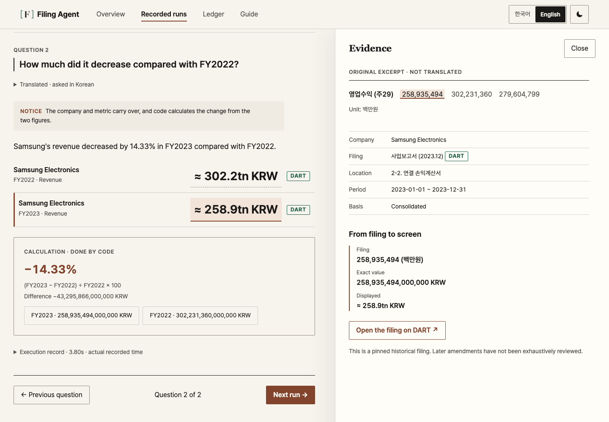

# Filing Agent

Ask follow-up questions about historical company filings and compare reported figures with their sources.

**[Recorded demo](https://filing-agent.vercel.app)** · Korean and English · [Engineering notes](https://filing-agent.vercel.app/engineering-en.html) · [Filing Digest](https://github.com/mhju0/filing-digest)

The public demo replays actual local runs. It makes no model calls and has no live question endpoint. The local app supports follow-up questions and saved investigations.



## Engineering decisions

- Gemma through Ollama interprets the question without receiving filing text or financial values. Code selects evidence, calculates with `Decimal` and renders the Korean or English answer.
- A pinned historical snapshot bounds supported companies, periods and metrics. Missing or unsupported evidence produces a clarification or withheld figure rather than an invented value.
- LangGraph stages and PostgreSQL preserve completed work for explicit retry. Saved investigations freeze their evidence; results that fail to reach storage are not durable.

Python 3.11 · FastAPI · LangGraph · PostgreSQL · Ollama · React + TypeScript

## Run locally

The qualified setup uses an Apple Silicon Mac (16 GiB RAM tested), Python 3.11, Node 24, PostgreSQL 16 tools and pinned Ollama/Gemma versions.

```bash
python3.11 -m venv .venv
.venv/bin/pip install -r slice/requirements.lock
npm ci --prefix slice/web
npm run build --prefix slice/web
```

Continue with the [operating guide](slice/README.md) to verify the model digest, start the separate local database and launch the app at `http://127.0.0.1:8765`. It also covers recovery, backups and replay exports. Keep the services on loopback with one application worker.

## Scope

The catalog contains revenue, operating income and as-reported net income for Samsung Electronics FY2022–2023, NAVER FY2023 and Microsoft FY2023–2024. Refresh uses the approved snapshot; it does not fetch newer filings. Agent does not call Digest during a question.

[Evaluations](evals/README.md) use project-authored scenarios on this collection. They do not establish general financial-language accuracy or multi-user readiness.

Maintenance only. [Documentation](docs/README.md) · [Architecture decisions](docs/adr/README.md) · [Maintenance policy](docs/MAINTENANCE.md)

## License

Copyright (c) 2026 Michael Ju. All rights reserved. The public source archive is available for portfolio review; no open-source license is granted for original project code. Dependency, model and bundled font licenses apply separately.
